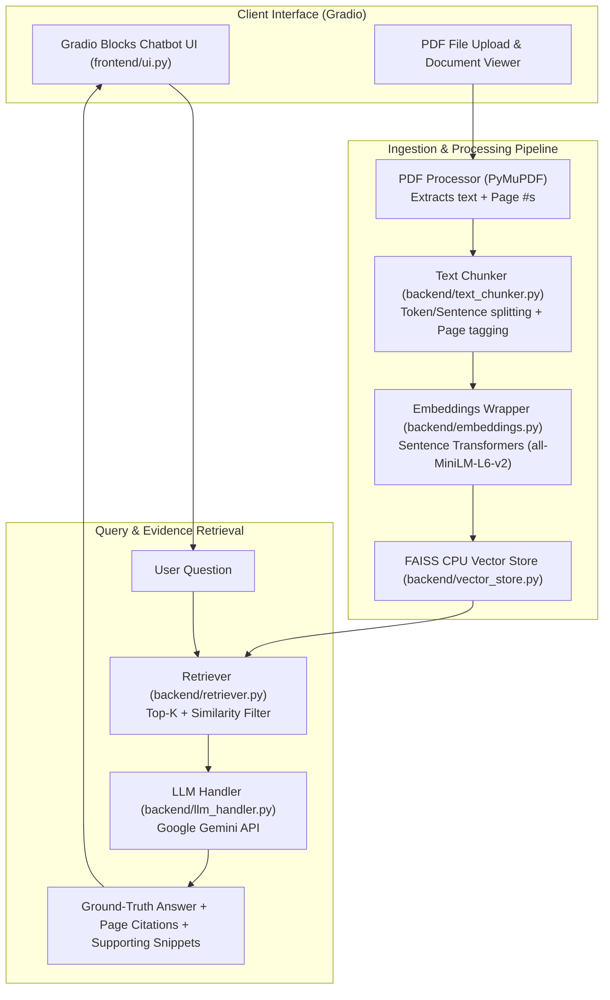

# System Architecture

## 1. High-Level Architecture

The Reading Passage Evidence Locator follows an Evidence-Grounded Retrieval-Augmented Generation (RAG) architecture built with modular Python components and a Gradio web interface.

## 2. Component Breakdown

1. **Frontend (`frontend/ui.py`)**:
   - Built with Gradio Blocks.
   - Includes document upload drawer, interactive chat window, citation inspection panels, and clear/reset controls.

2. **PDF Processor (`backend/pdf_processor.py`)**:
   - Leverages `PyMuPDF` (`fitz`) for extraction.
   - Captures per-page text with accurate page indexes and metadata.

3. **Text Chunker (`backend/text_chunker.py`)**:
   - Breaks text into overlapping segments.
   - Tags every chunk with `{"doc_name": ..., "page_num": ..., "chunk_id": ...}`.

4. **Embedding Manager (`backend/embeddings.py`)**:
   - Wraps `sentence-transformers` (`all-MiniLM-L6-v2` by default).
   - Singleton/cached instance pattern to prevent redundant model initialization.

5. **Vector Store (`backend/vector_store.py`)**:
   - Manages FAISS IndexFlatIP (Inner Product / Cosine Similarity with normalized vectors).
   - Stores chunk metadata in memory for zero-overhead retrieval.

6. **Retriever (`backend/retriever.py`)**:
   - Executes nearest-neighbor search.
   - Filters out chunks below the minimum similarity threshold.

7. **LLM Handler (`backend/llm_handler.py`)**:
   - Formulates strict evidence-conditioned prompts for Google Gemini API.
   - Parses answer, extracted quotes, page citations, and handles abstention decisions.
